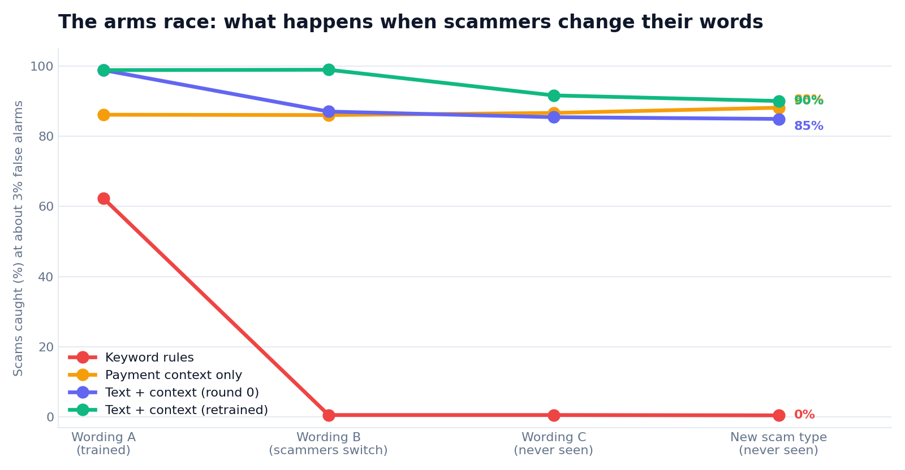
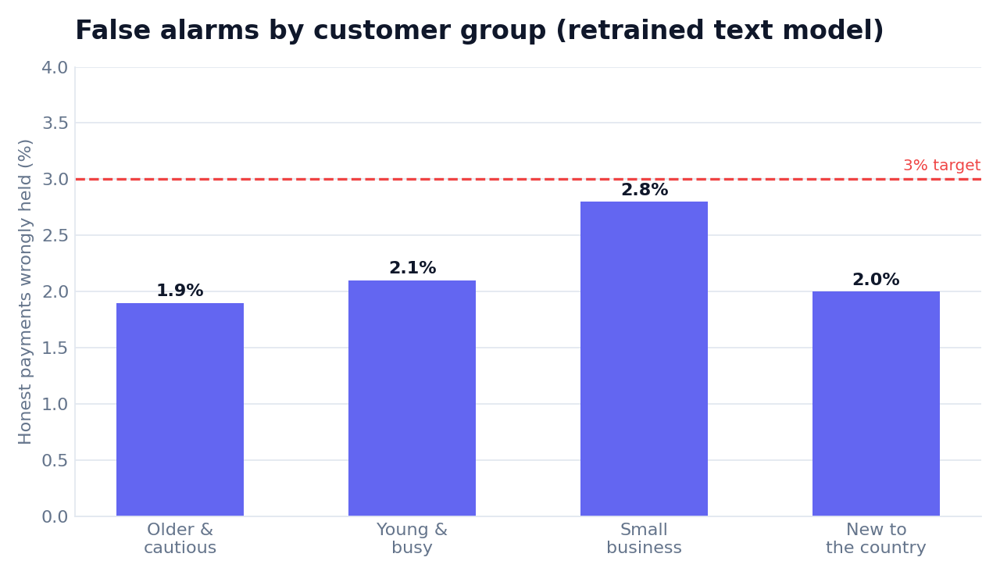

# ScamShield Arena


A small arena for testing scam defences. Scripted "scammers" change their wording when they are caught, and a "guardian" decides whether to hold a payment for a human call-back. The arena measures how many scams are stopped, how many honest payments are wrongly held, and whether the guardian treats different customer groups equally.

**Everything here is synthetic and deliberately generic.** Conversations are built from short template phrases that express well-known warning signs (urgency, secrecy, pressure to move money). There are no real names, brands, numbers, scripts or step-by-step methods. This is a test bench for defence, not a guide to scamming.

## What is in it

- `arena/scenarios.py`: five scam types and seven kinds of honest conversation, four customer groups (older and cautious, young and busy, small business, new to the country). Three wording sets: A (common), B (what scammers switch to), C (never used in training). One scam type, `tech_support`, is never used in training.
- Hard cases: 30% of scams show only one warning sign, scams borrow ordinary cover phrases, and 30% of honest conversations contain a warning-sign phrase (a real landlord saying "urgent", a surprise party kept "secret").
- `arena/guardian.py`: three guardians: fixed keyword rules, payment context only (new payee, amount versus usual), and a text-plus-context model (TF-IDF with logistic regression).
- `arena/evaluate.py`: round 0 trains on wording A. Round 1 retrains after scammers switch to B. Wording C and the new scam type are never trained on. Each guardian's threshold is set on validation data to allow about 3% false alarms. Averaged over 5 seeds.
- `arena/api.py`: `POST /screen` returns `allow` or `hold_for_callback` with the words that drove the score. A hold means a person checks with the customer. The customer is never accused.

## Run

```
pip install -r requirements.txt
python -m pytest -q
python -m arena.evaluate     # writes results.json (deterministic, about 6 seconds)
python -m arena.report       # redraws the figures in docs/img from results.json
uvicorn arena.api:app        # then open http://127.0.0.1:8000/ for the live demo
```

Open `/` for an interactive page: pick a preset conversation (including a reworded scam and an honest surprise-party message), change the amount, and see the verdict, a risk meter against the hold threshold, and the words that drove the score. `GET /health` reports whether the model is ready. `POST /screen` rejects empty text, non-positive amounts and text over 5,000 characters with a 422.

## Results (5 seeds, `results.json`, catch rate at about 3% false alarms)

| Guardian | Wording A | B (switched) | C (unseen) | New scam type |
|---|---|---|---|---|
| Keyword rules | 62% | 1% | 1% | 1% |
| Payment context only | 85% | 84% | 85% | 87% |
| Text + context, round 0 | 99% | 87% | 85% | 85% |
| Text + context, round 1 (retrained with B) | 99% | 99% | 92% | 90% |



- Fixed keyword rules collapse as soon as scammers reword.
- Payment context alone is stable but caps around 85%, because it cannot see the conversation.
- The text model loses 12 points when wording changes, and retraining on what scammers did last round recovers most of it. Retraining does not fully cover wording it has never seen (92%).
- False-alarm rate by customer group for the round-1 text model: older and cautious 1.9%, young and busy 2.1%, small business 2.8%, new to the country 2.0%. The gaps are small here, but the groups differ only in a few template phrases. This does not show the system is fair for real customers.



## Limits

- The data is template text with a small vocabulary. Real scams are far more varied, and real conversations are messier, so real catch rates will be lower. I first built an easier version and got 100% on unseen wording, which is how I know the harder cases matter.
- The scammers are scripted, not an LLM. The "arena" is a simple retrain loop, not a learning opponent.
- No real languages, voice calls or message metadata are covered.

## Author

Abhinav Annareddy
