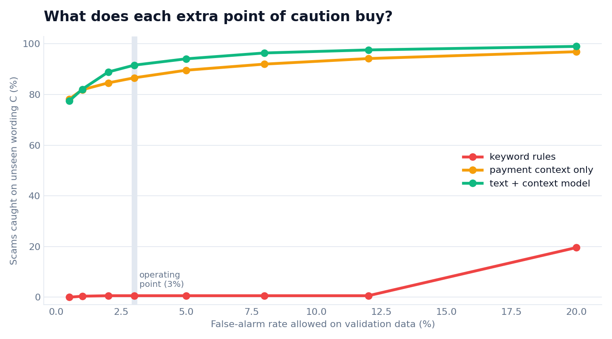

# ScamShield Arena


Scammers change their words as soon as a phrase gets caught. A defence that was tested only on yesterday's wording can look great and then fail the week after. ScamShield Arena is a small, safe test bench for that problem. Scripted "scammers" reword their pitch, a "guardian" decides whether to hold a payment for a human call-back, and the arena measures three things: how many scams are stopped, how many honest payments are held by mistake, and whether different customer groups are treated equally.

**Everything here is synthetic.** Conversations are built from short template phrases that express well-known warning signs: urgency, secrecy, pressure to move money. There are no real names, brands, numbers, scripts or step-by-step methods. This is a test bench for defence, not a guide to scamming.

## Try it

```
pip install -r requirements.txt
python -m pytest -q
uvicorn arena.api:app
```

Then open http://127.0.0.1:8000/. Pick a preset conversation (a bank-style scam, the same scam reworded, a plain rent payment, an honest surprise-party message), change the amount, and see the verdict, a risk meter against the hold threshold, and the words that pushed the score up.

For the API, `POST /screen` returns `allow` or `hold_for_callback` and the words behind a hold. A hold means a person checks with the customer. The customer is never accused. Empty text, non-positive amounts and text over 5,000 characters get a 422. `GET /health` says whether the model is ready.

## What happens when scammers reword


Catch rate at about 3% false alarms on validation data, averaged over 5 seeds (`results.json`):

| Guardian | Wording A | B (switched) | C (unseen) | New mix of warning signs |
|---|---|---|---|---|
| Keyword rules | 62% | 1% | 1% | 1% |
| Payment context only | 85% | 84% | 85% | 87% |
| Text + context, round 0 | 99% | 87% | 85% | 85% |
| Text + context, round 1 (retrained with B) | 99% | 99% | 92% | 90% |

- Fixed keyword rules collapse as soon as scammers reword.
- Looking only at the payment is steady but tops out around 85%, because it never reads the conversation.
- The text model loses 12 points when the wording changes. Retraining on what scammers used last round wins most of that back, but wording it has never seen still costs about 7 points.
- The last column is tech support, which is never used in training. It reuses warning signs the model has seen in other scam types, so it is a new mix, not a new language. The [audit](docs/AUDIT.md) explains this.

More charts and the full reading of the results are in [docs/FINDINGS.md](docs/FINDINGS.md), including the trade-off between catching more scams and holding more honest payments:



## Is it fair across customer groups?


For the retrained text model, honest payments held by mistake were 1.9% for older and cautious customers, 2.1% for young and busy, 2.8% for small businesses and 2.0% for people new to the country. Small businesses are held about 47% more often, and most of that comes from supplier-invoice conversations. The groups differ only in a few template phrases, so this does not show the system is fair for real customers. It shows the kind of check to run on real data.

## What is in the repository

| Path | What it does |
|---|---|
| `arena/scenarios.py` | Generates the conversations: 7 tactics, 5 scam types, 7 honest situations, 4 customer groups, 3 wording sets (A, B, C) |
| `arena/guardian.py` | The three guardians: keyword rules, payment context only, text + context model |
| `arena/evaluate.py` | Runs the rounds over 5 seeds and writes `results.json` |
| `arena/extras.py` | Per-scam-type catch, realised false-alarm rates and the trade-off curve (`results_extra.json`) |
| `arena/report.py`, `arena/figures_extra.py` | Draw every figure in `docs/img` from the results files |
| `arena/api.py`, `arena/static/` | The screening service and the demo page |
| `tests/` | 12 tests: data generation, guardians, thresholds, the API and the figures |
| `docs/` | [Method](docs/METHOD.md), [findings](docs/FINDINGS.md) and an [audit of this project's own claims](docs/AUDIT.md) |

To regenerate the results and charts:

```
python -m arena.evaluate
python -m arena.extras
python -m arena.report
python -m arena.figures_extra
```

## Limits

- The data is template text with a small vocabulary. Real scams are far more varied and real conversations are messier, so real catch rates will be lower. An easier first version of this bench scored 100% on unseen wording, which is how I learned the harder cases matter.
- At real-world rates, where almost every payment is honest, most holds would still be honest customers. See the worked example in [docs/FINDINGS.md](docs/FINDINGS.md).
- The scammers are scripted, not an LLM. The "arena" is a simple retrain loop, not a learning opponent.
- The 3% false-alarm target is set on validation data. Realised rates on the test sets ranged from 0% to 3.6%. See the [audit](docs/AUDIT.md).
- Five seeds, no confidence intervals. Treat differences of a point or two as noise.
- No real languages, voice calls or message metadata are covered.

## How it was made

I built the idea with the help of an AI assistant (Claude) and then tested and reviewed it. Every number and figure above comes from code in this repository and can be regenerated with the commands shown. The [audit](docs/AUDIT.md) records what was checked and what was corrected.

## Author

Abhinav Annareddy
