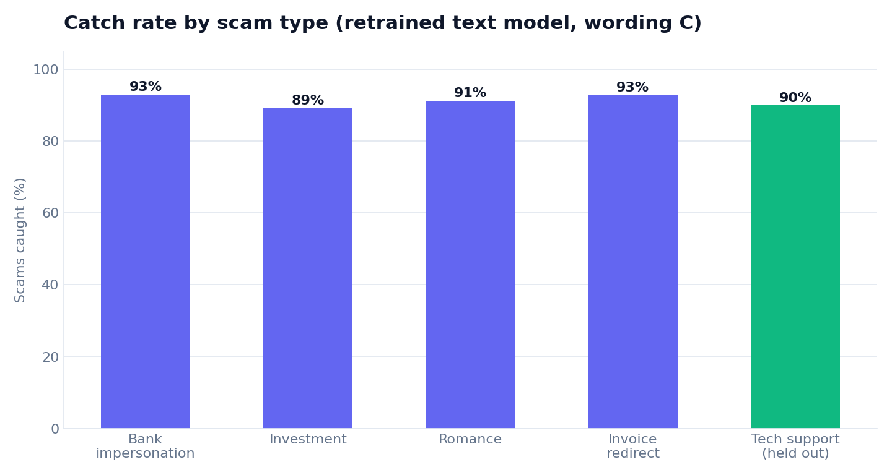
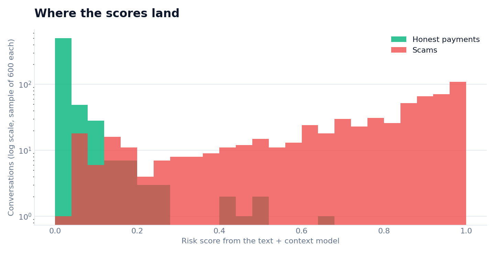

# Findings

All numbers are averages over 5 seeds on synthetic data. See [AUDIT.md](AUDIT.md) for how far to trust them.

## 1. Fixed word lists break the moment wording changes

Keyword rules catch 62% of scams in the wording they were written for, and under 1% once scammers switch to B or C. The rules aren't wrong about what a scam looks like. They are tied to specific words.

## 2. Payment context is steady but capped

Looking only at the payment (new payee, amount versus usual) catches about 85% to 88% whatever the wording, because the wording never enters into it. It also cannot get any better, since it never reads the conversation.

## 3. Reading the text helps, until the words change

The text model catches 99% on the wording it trained on. On wording B it falls to 87%, on C to 85%. Retraining on B restores B to 99% and lifts C to 92%, but wording it has never seen still costs it about 7 points.

## 4. More caution has a price, and it flattens out

On unseen wording C, allowing 1% false alarms catches about 82%. At 3% it is about 92%, and at 5% about 94%. Past 5% each extra point of false alarms buys very little. The 3% operating point sits near the bend of the curve, which is why it was chosen.

## 5. The new scam type was caught about as well as the old ones

Tech support, never trained on, was caught at 90%, in the same range as the four trained types (89% to 93%). That is a good result, but the audit explains why it is less of a surprise than it looks: tech support shares tactics with the other types.

## 6. Scores separate scams from honest payments cleanly, with a tail

Most honest payments score near zero. Most scams score high. The scams that get through sit in the low-score tail. Scams showing one warning sign are caught 87% of the time on wording C, against 93% to 95% for scams showing two or three (checked on the 5-seed test sets).

## 7. False alarms are spread unevenly

For the retrained text model, honest payments wrongly held ranged from 1.9% (older and cautious) to 2.8% (small business). Everyone is under the 3% target, but small businesses are held about 47% more often than older customers. Much of that gap comes from one situation: supplier-invoice conversations, which small businesses have and the other groups don't, were wrongly held 5.7% of the time on wording C. Whether anything like this happens with real customers is an open question this project cannot answer.

## What the numbers do not say

At the 3% operating point, with scams making up 40% of test conversations, a hold is usually a real scam. Real payment streams are almost all honest. Suppose 1 payment in 200 is a scam, the guardian catches 92% of them and wrongly holds 3% of honest ones. Then roughly 7 in 8 holds would be honest customers. This is simple arithmetic, not a measured result, and it is the main reason the call-back step has to be cheap and polite.
