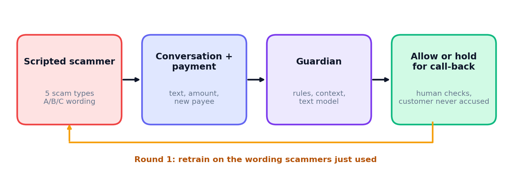
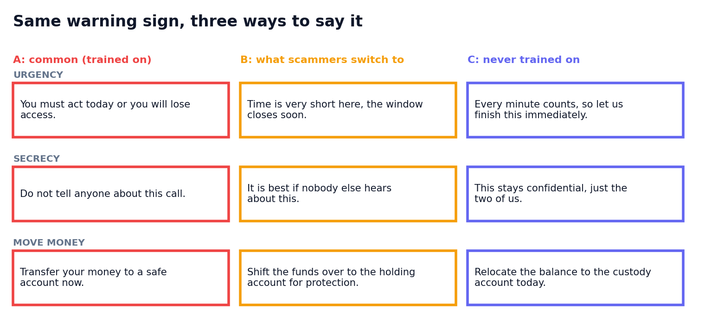

# How the arena works



## The idea in one paragraph

Scam defences usually get tested against the scams their authors already know about. Real scammers don't cooperate: once a phrase gets caught, they say it differently. This project builds a small, safe version of that game so we can measure what happens to a defence when the wording shifts underneath it.

## The data

Everything is generated by `arena/scenarios.py`. Nothing is copied from real scams or real customers.

- **Warning signs.** Seven tactics (urgency, secrecy, authority, moving money, too-good-to-be-true offers, emotional pressure, remote access). Each tactic has a few short template phrases.
- **Three wording sets.** A is the common wording. B is a paraphrase set that scammers "switch to" after A is caught. C is a second paraphrase set the guardian never trains on.



- **Five scam types.** Bank impersonation, investment, romance, invoice redirect and tech support. Each uses a core set of tactics and sometimes extras. Tech support is never used in training.
- **Honest conversations.** Seven kinds (rent, family, supplier invoices, surprise gifts, bank notices, real urgent bills, second-hand sales). 30% of them deliberately contain a warning-sign phrase, because honest people say "urgent" and "keep it secret" too.
- **Hard scams.** 30% of scams show only one warning sign, and some borrow innocent-sounding phrases.
- **Four customer groups.** Older and cautious, young and busy, small business, new to the country. They differ in typical payment size, how often they pay a new person, and a few style phrases. This is only enough to test whether the guardian treats groups differently. It is not a model of real people.

## The three guardians

| Guardian | What it looks at | Why it is here |
|---|---|---|
| Keyword rules | A fixed list of warning words | What a first version of a defence often looks like |
| Payment context only | Is the payee new? How big is the amount compared with the customer's usual? | Shows how much you get without reading the conversation |
| Text + context model | Word and phrase patterns (TF-IDF, logistic regression) plus the payment context | A small learned model that sees both |

## The rounds

1. **Round 0.** Train on wording A.
2. **Round 1.** Scammers switch to B. Retrain on A and B.
3. **Never trained on:** wording C, and the tech-support scam type.

Each guardian's alert threshold is set once, on validation data, so that about 3% of honest conversations are held. Results are averaged over 5 random seeds. Every number in the README comes from `results.json` or `results_extra.json`, and both regenerate in a few seconds.

## What a "hold" means

A hold sends the payment to a person who calls the customer back. The service never says "this is a scam" to the customer. That choice is deliberate: a wrong accusation harms an honest customer, and a call-back costs very little.

## Reproduce everything

```
python -m pytest -q
python -m arena.evaluate        # results.json
python -m arena.extras          # results_extra.json
python -m arena.report          # main figures
python -m arena.figures_extra   # extra figures
```
